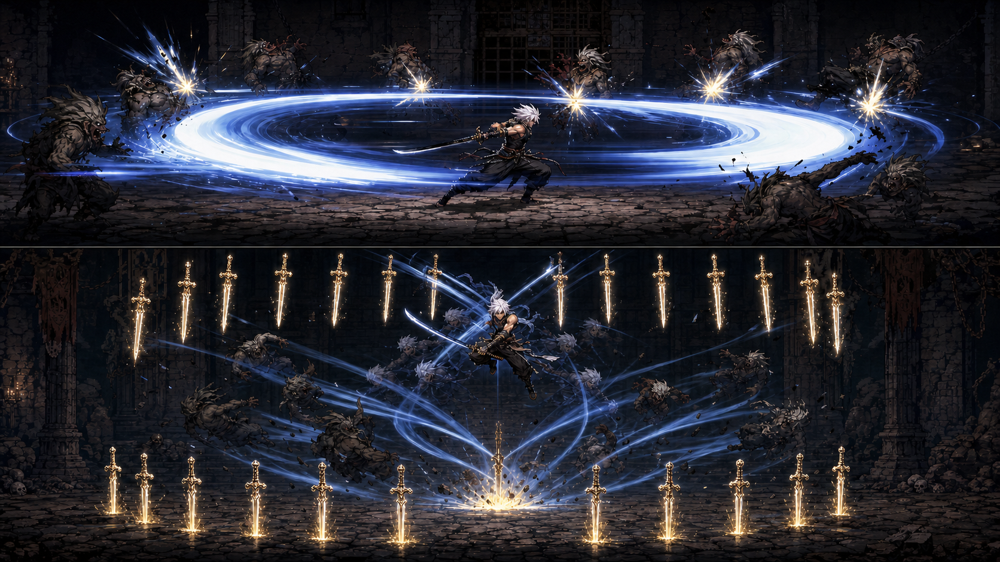
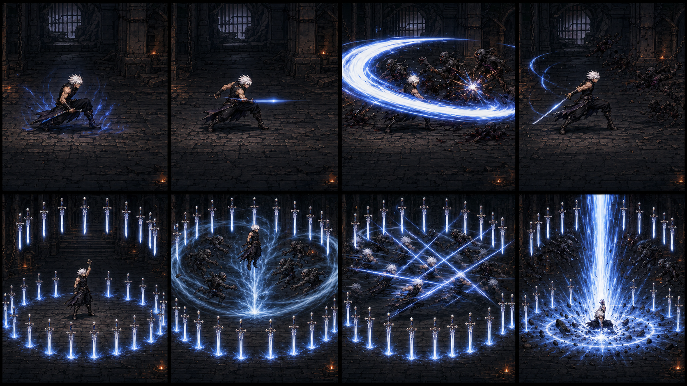

# 全游戏美术、材质与动画重制设计

日期：2026-07-21

状态：待用户书面验收

## 1. 目标

本阶段把当前以单帧占位图和程序化特效为主的画面，升级为统一、高完成度的 2.5D 横版动作 ARPG 美术系统。第一优先级是以原版 DNF 的战斗节奏和镜头表现为参考，重做剑魂的拔刀斩与第一次觉醒“极·鬼剑术（暴风式）”，随后把同一标准扩展到玩家、现有八类怪物、四种房间生态、装备与 UI。

验收重点不是静态截图“像”，而是动作状态、伤害时点、位移曲线、拖尾、材质受光和命中特效共同形成完整动态表现。

## 2. 范围与非目标

### 本次范围

- 玩家全动作动画、武器分层、拔刀斩和暴风式。
- 火、水、雷、混沌四类房间的地面、墙体、门、光照和装饰。
- 现有八类怪物的动作与材质重制。
- 房间装饰、可破坏物和实体障碍物。
- 现有装备、地面掉落、材料、技能石和 UI 图标。
- 资源导入、图集打包、材质描述、动画事件、校验与低资源档位。

### 明确不做

- 不增加光剑、太刀或其他武器专精分支。
- 不因为美术重制擅自增加当前项目不存在的怪物、Boss、技能或玩法系统。
- 不改变存档语义、装备数值、掉落概率和房间词条规则。
- 不在本轮重制全套音频；保留现有音频，仅补齐动画事件同步接口，音频资产另立里程碑。

## 3. 当前基线

当前 `material_manifest.hpp` 中玩家 12 个状态、八类怪物各 7 个状态均以单帧资源为主；环境含四套地面、四扇门和一个下层洞；特效和掉落图标数量有限。当前拔刀斩是前方矩形单次伤害，暴风式是中心点连续判定，均缺少原版式完整演出。此次重制保留现有玩法数据入口，但替换显示资产、动画驱动和技能演出实现。

## 4. 视觉基准

采用方案 B：蓝白能量、暗钢与古金实体剑、暗色地下城。

- 能量核心：`#F8FBFF`
- 内层青蓝：`#82CFFF`
- 运动主蓝：`#2469C9`
- 外缘深蓝：`#102653`
- 金属高光古金：`#D7A94E`
- 命中火花：克制的琥珀色，不使用大面积橙红覆盖技能主色。
- 地下城：炭黑、冷灰、低亮古金点缀，使角色和技能轮廓始终清晰。

选定色彩与材质基准：

技能演出阶段参考：

上述图片是项目视觉基准，不是可直接入库的最终逐帧资产。最终资源必须保持角色、武器、地面和 UI 的一致比例与可读性。

## 5. 资产与渲染架构

采用“高质量 2D 关键帧序列 + raylib 运行时插值与特效”的混合方案，不改为实时 3D，也不使用纸片人骨骼拼接作为最终角色表现。

### 源资产

- 每个角色动作保存分层源文件：身体、武器、前景特效、遮挡特效、阴影。
- 角色帧保持统一画布、脚底锚点和朝向规范。
- 武器锚点独立记录，允许普通动作复用身体帧但不允许以重复画面虚增帧数。
- 环境按地面、墙体、门、前景遮挡、发光体、可破坏物和实体障碍物分类。

### 运行时资产

- 每个图集使用一张颜色图和一张打包材质图。
- 材质图：`R/G` 为八面体编码法线，`B` 为粗糙度，`A` 为发光遮罩。
- 金属度不与法线和发光争抢通道；由图集条目中的材质类别或每精灵常量提供。暗钢、古金、布料、皮肤、石材各有独立参数。
- 图集条目记录 UV、原始尺寸、脚底锚点、武器锚点、碰撞参考点和材质类别。
- 当前房间只加载玩家、当前生态、当前环境和通用 UI，切换房间时释放不再使用的生态资源。

## 6. 动画帧数与播放标准

所有帧必须产生可辨识的姿态、轮廓、武器弧线或受力变化；禁止复制帧凑数。精灵主体以 24–30 fps 播放，游戏逻辑、曲线插值、粒子和拖尾以 60 Hz 更新。

### 玩家

| 动作 | 最低有效帧数 |
|---|---:|
| 待机 | 16 |
| 移动 | 20 |
| 跳跃完整循环 | 24 |
| J 第一段 / 第二段 / 第三段 | 18 / 22 / 26 |
| L 上挑 | 24 |
| 受击 | 10 |
| 倒地 | 16 |
| 起身 | 14 |
| 死亡 | 24 |
| 拔刀斩 | 36 |
| 暴风式角色动作 | 不少于 96，完整演出约 6 秒 |

### 怪物

| 类型 | 动作 | 最低有效帧数 |
|---|---|---:|
| 普通怪 | 待机 / 移动 / 攻击 / 受击 / 死亡 | 12 / 16 / 20 / 8 / 16 |
| 精英 | 攻击或特殊动作 | 24–32 |
| Boss（以后存在时） | 待机 / 移动 / 攻击 / 技能 / 死亡 | 18 / 24 / 30 / 32–48 / 36 |

每段动画元数据必须包含：帧范围、帧速率、脚底锚点、武器锚点、伤害帧、无敌帧、移动曲线、取消窗口、音效事件和特效事件。

## 7. 两个主动技能

### 7.1 拔刀斩

- 保留原版式较长蓄势：压低重心、手搭刀柄、能量收束，再瞬间拔刀。
- 不制作光剑追加斩、太刀多段或其他武器分支。
- 主体为一次完整的周身椭圆形斩击，而不是当前前方矩形判定。
- 36 帧分为蓄势、拔刀爆发、斩环扩张、收刀四段。
- 伤害只结算一次；伤害帧与最亮的白色刃核严格同步。
- 特效至少包含蓄力辉光、白色刃核、青蓝内层、深蓝外缘、琥珀火花、地面碎屑和短时残影。
- 斩击边界清晰，不用大面积半透明雾遮挡敌人受击状态。

### 7.2 极·鬼剑术（暴风式）

- 总演出约 6 秒，保持长觉醒技能的完整节奏，不压缩成普通连击。
- 精确生成 24 把暗钢古金实体剑：12 把插入地面形成剑阵，12 把悬浮于空中。
- 启动阶段把范围内敌人牵引到中心并连续硬直；牵引速度有上限，不能把敌人瞬移穿过实体障碍。
- 玩家进入空中高速多段斩击，角色动作不少于 96 个有效帧，剑体与蓝白轨迹保持可分辨。
- 空中连斩阶段玩家无敌；启动和最终落地恢复阶段不自动获得全程无敌。
- 终结为白蓝能量柱与古金撞击闪光，落地帧同步最后一次伤害、震屏和碎屑。
- 剑阵、吸附、逐次斩击、终结伤害均由动画事件驱动，不允许靠独立计时器漂移。

两个技能继续作为主动技能石使用，不改成角色固有技能。槽位 1 默认装拔刀斩，槽位 2 默认装暴风式，五个槽位均可取出和更换；辅助技能石槽位继续保留但本阶段不实现辅助效果。

## 8. 输入约定

- 五个主动技能槽只默认绑定小键盘 `NumPad 1 / 2 / 3 / 4 / 5`，对应 raylib 的 `KEY_KP_1` 至 `KEY_KP_5`。
- 主键盘数字行 `1–5` 不触发主动技能，避免与此前错误映射混淆。
- HUD 显示 `Num1`、`Num2`、`Num3`、`Num4`、`Num5`。
- 设置中提供按键重绑定，作为无小键盘设备的可用性兜底；不得以默认双绑定的方式重新启用数字行。

## 9. 房间物品与障碍物

按实例数量的目标比例生成：

- 70% 背景装饰：火把、锁链、旗帜、武器架、骨堆、破墙，仅参与遮挡与光照，不参与碰撞。
- 20% 可破坏物：木箱、陶罐、路障、推车、祭坛，初始短暂阻挡，破坏后移除碰撞并低概率掉落通用材料。
- 10% 实体障碍物：石柱、塌墙、深坑、雕像，玩家和怪物均需绕行。

生成器必须保护四扇门、下层洞、玩家出生区和怪物出生区，且始终保留至少两条可通行战斗路线。障碍布局校验失败时重新生成本组物件，不能改变房间、怪物、词条或掉落结果。

物件使用独立、可复现的随机流；同一房间种子和物件版本得到相同布局，且不得消耗怪物、掉落、词条随机数序列。

## 10. 实施里程碑

1. 玩家全动作、武器分层、拔刀斩、暴风式、NumPad 槽位输入。
2. 火焰房间纵向切片：地面、门、光照、火系怪物、装饰、可破坏物、实体障碍物。
3. 水、雷、混沌房间及余下六类怪物。
4. 装备外观、地面掉落、材料、技能石和 UI 图标。
5. 图集压缩、低资源档位、统一光照、移除已替换的旧占位资源引用。

每个里程碑单独实现、验证和验收，禁止为了后续阶段提前大范围替换当前可运行资源。

## 11. 运行时数据流

1. 战斗状态机决定动画状态和朝向。
2. 动画播放器从剪辑元数据推进帧并应用脚底/武器锚点。
3. 到达事件标记时，依次触发伤害、位移、无敌、牵引、特效、震屏和音效。
4. 渲染器按阴影、后景特效、角色身体、武器、前景特效、遮挡物和 UI 顺序绘制。
5. 状态中断只能在剪辑定义的取消窗口发生；中断后必须清理临时碰撞体、无敌、牵引和特效句柄。

动画帧是表现时间轴，战斗判定仍由确定性逻辑产生。重放相同输入时，伤害结果和房间随机结果必须一致。

## 12. 性能和资源预算

- 当前房间运行时纹理显存目标不超过 256 MB。
- 30 个怪物同时存在并施放暴风式时，目标 60 fps，1% low 不低于 45 fps。
- 粒子、残影、动态灯和地面碎屑均使用对象池，不在每帧分配内存。
- 同类怪物共享图集和材质，不按实例复制纹理。
- 低资源档位降低粒子数量、拖尾采样和动态灯数量，不删减技能伤害帧、敌人提示帧或关键角色姿态。

## 13. 失败处理

- 资源加载失败时显示醒目的占位图，同时记录资源 ID、路径和错误原因；不得静默显示空白。
- 剪辑元数据缺失时禁止进入游戏主循环，并列出缺失项。
- 可选材质图缺失时可使用安全默认材质，但必须输出警告；颜色图或动画帧缺失属于硬错误。
- 技能被中断、房间切换或玩家死亡时，统一释放临时剑阵、牵引区、碰撞体、粒子和灯光。

## 14. 自动校验与验收

### 自动校验

- 检查所有剪辑帧数、图集边界、锚点范围、事件顺序和材质引用。
- 对连续帧做感知哈希检查，报告空白帧和高度重复帧，人工确认后才能豁免。
- 验证拔刀斩只有一次伤害事件，暴风式有且仅有 24 把剑并在结束/中断后全部回收。
- 验证默认输入只响应 `KEY_KP_1..KEY_KP_5`，数字行 `KEY_ONE..KEY_FIVE` 不触发技能。
- 用固定种子验证物件布局可复现且不改变怪物、掉落和词条序列。
- 对 30 怪 + 暴风式压力场景记录平均帧率、1% low、峰值纹理显存和对象池峰值。

### 人工验收

- 每个里程碑提供游戏内截图和慢速动画录屏检查。
- 检查脚底不漂移、武器不脱手、朝向翻转正确、伤害帧与画面冲击同步。
- 检查四类房间敌我轮廓清晰、门和下层洞可辨识、两条战斗路线真实可通行。
- 完整回归移动、跳跃、J 连击、L 上挑、受击、倒地、死亡、掉落、房间切换和存档读取。

## 15. 外部表现参考

- [DNF Wiki：剑魂技能目录](https://dnf.fandom.com/zh/wiki/%E5%89%91%E9%AD%82)
- [旧版拔刀斩资料页](https://m.dnfziliao.com/skill/jianhun/badaozhan.asp)
- [极·鬼剑术（暴风式）资料](https://www.baike.com/wikiid/7844417382429376598)

外部页面仅用于确认经典动作结构与技能辨识度。项目中的代码、逐帧图、特效、材质和 UI 必须自行制作，不直接复制原游戏受版权保护的资产。

## 16. 决策结论

设计范围、色彩、技能结构、帧数、材质方案、物件比例、性能目标、里程碑顺序和 NumPad 输入均已明确，无待定占位项。下一步在用户验收本文件后，编写逐任务实施计划；在计划获批前不进入生产代码实现。
